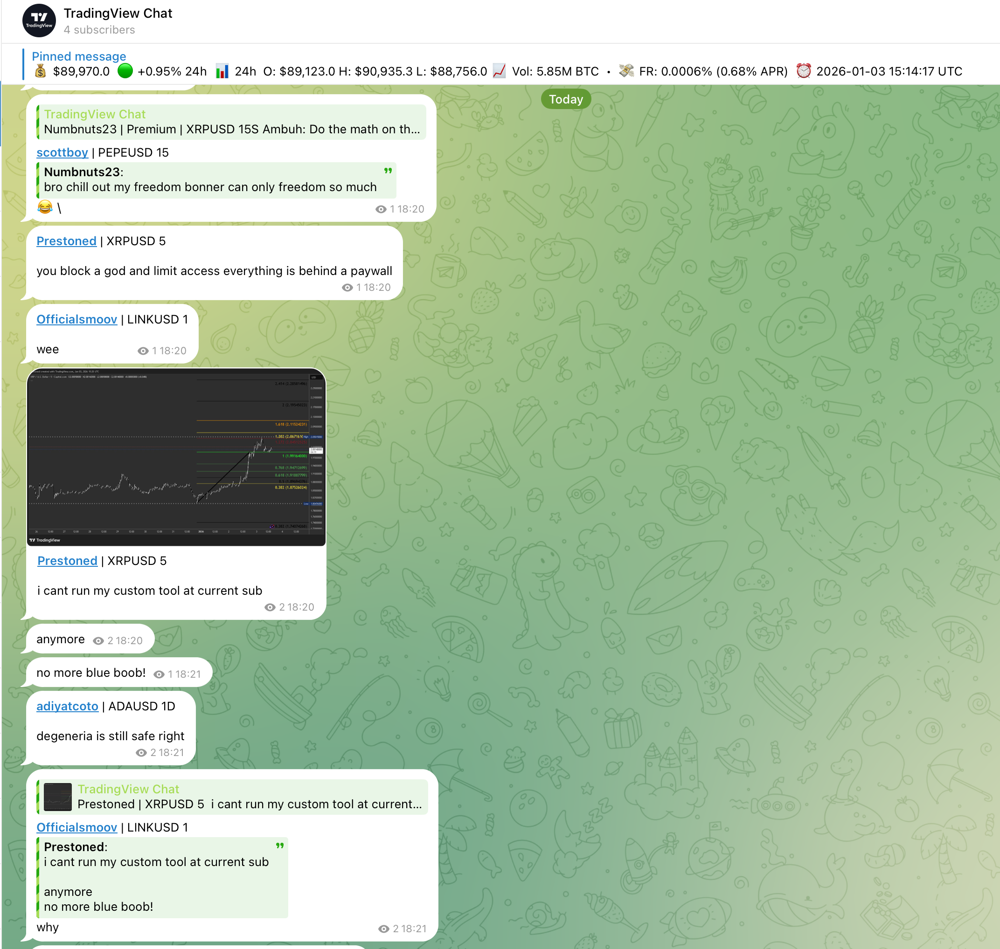

# TradingView Chat Scraper

Real-time scraper for TradingView public chat. Saves messages to PostgreSQL and forwards to Telegram.

> ⚠️ **TradingView retired public chats on Sep 30, 2026** ([announcement](https://www.tradingview.com/support/solutions/43000591339-public-chats-are-being-retired-on-sep-30-2026/)), `/chat/` now returns 404. The `scraper` service is disabled by default (compose profile `scraper`). New posts now come from **TradingView Minds** (`minds` service), see [PROGRESS.md](PROGRESS.md).

**Live demo:** [@trading_view_chat](https://t.me/trading_view_chat)



## Features

- 🔍 Scrapes TradingView chat via Puppeteer + MutationObserver
- 💾 Stores users, messages, ideas, images in PostgreSQL
- 📨 Forwards to Telegram with formatting and images and replies
- 💰 Updates pinned message with BTC price (OKX API)
- 🧹 Auto-cleanup of old images

## How it works

### Scraper (`cli/stream.js`)

1. **Puppeteer** launches headless Chrome, navigates to TradingView chat
2. **MutationObserver** injected into page detects new `.ch-item` DOM nodes
3. New messages extracted, normalized (emojis, quotes, images) and sent to Node.js via `page.exposeFunction()`
4. Messages saved to PostgreSQL, published to Redis pub/sub

### Reliability

- **Keepalive**: Scrolls page every 30s to keep chat rendering
- **Health check**: Every 3 min checks DB freshness. If no messages for 5 min → `process.exit(1)` → Docker restarts container
- **Observer guard**: Re-installs MutationObserver every 15s if missing (handles SPA re-mounts)
- **Docker**: `restart: unless-stopped` ensures auto-recovery

### Telegram forwarder (`cli/telegram-forwarder.js`)

- Subscribes to Redis `chat:messages` channel
- Formats and sends to Telegram (text, photos, media groups)
- Handles rate limits with exponential backoff
- Updates BTC price every 60s via OKX public API

## Quick start

```bash
cp .env.example .env
# Edit .env with your Telegram bot token

docker compose up -d
```

## Configuration

| Variable | Description |
|----------|-------------|
| `ROOM_URL` | TradingView chat URL |
| `TELEGRAM_BOT_TOKEN` | Telegram bot token |
| `TELEGRAM_CHAT_ID` | Channel (@name or numeric ID) |
| `BTC_PRICE_MESSAGE_ID` | Message ID to update with BTC price (0=off) |
| `IMAGE_RETENTION_DAYS` | Days to keep images (default: 1) |

## Services

| Service | Description |
|---------|-------------|
| `minds` | Minds poller (BTCUSD + BTCUSDT feeds) → Postgres + Redis |
| `ideas` | Ideas poller → Telegram (chart + excerpt) with full text on Telegraph |
| `scraper` | Old chat scraper (disabled, `--profile scraper`) |
| `telegram` | Telegram forwarder + BTC price |
| `janitor` | Image cleanup |
| `postgres` | TimescaleDB (PostgreSQL 18) |
| `redis` | Pub/sub for real-time forwarding |

## Commands

```bash
docker compose logs -f minds     # Minds poller logs
docker compose logs -f ideas     # Ideas poller logs
docker compose logs -f telegram  # Telegram logs
```
